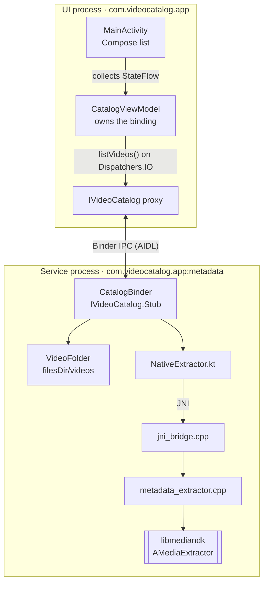
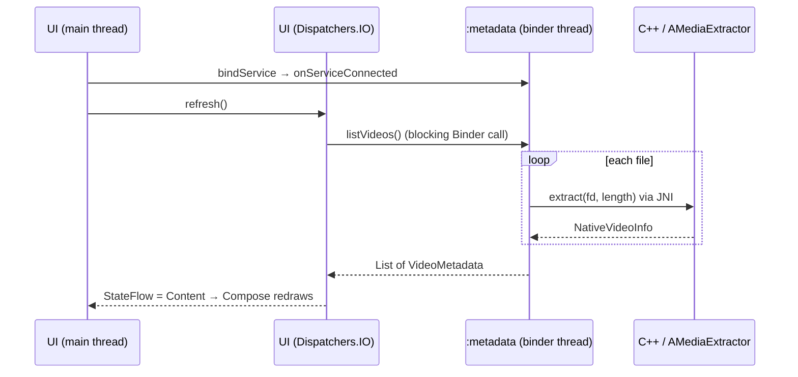

# Architecture: Video Metadata Catalog

| What | Name |
|---|---|
| Application ID (one APK) | `com.videocatalog.app` |
| UI process | `com.videocatalog.app` |
| Service process | `com.videocatalog.app:metadata` |

## Components

Data path: **UI → AIDL → Service → JNI → NDK → Service → AIDL → UI**.

## Runtime flow

The Binder call never runs on the main thread. The service creates no threads: each call runs on the binder thread that received it and shares no state, so concurrent calls are safe without locks.

## Key decisions

| Area | Decision | Why |
|---|---|---|
| Processes | One APK, service in `android:process=":metadata"`, `exported="false"` | Meets the two-process requirement with one attribute; a native crash can't take down the UI |
| AIDL | One blocking call, `List<VideoMetadata> listVideos()` | Simplest correct design for a small folder; no path parameter, so the client can't name files |
| Data model | Structured AIDL parcelable + `ExtractStatus` enum | Contract lives in `.aidl` files; per-file errors are data, so one bad file never fails the list |
| Folder | `filesDir/videos`, seeded once from `assets/samples/` on a binder thread | App-private storage the service owns; zero-setup demo; no disk I/O on the main thread |
| JNI | `extract(fd, length)` returns a typed `NativeVideoInfo`; `RegisterNatives` in `JNI_OnLoad` | Kotlin owns the file, C++ only borrows the fd; signature errors fail at load time |
| Native code | Plain C++17, RAII (`unique_ptr`) over `AMediaExtractor` / `AMediaFormat` | Every handle released on every path; metadata only, nothing is decoded |
| Client | ViewModel owns the binding; one `StateFlow`; Compose UI | Survives rotation and day/night switches; reconnects automatically if the service dies |
| Build | Single module, CMake, `minSdk 33`, `@Keep` on JNI classes | One APK for phone and Android Automotive; R8 can't break the JNI lookups |

## Limitations

- The whole list travels in one Binder reply (1 MB buffer), which is fine for a small folder.
- Both processes share one UID, so folder ownership is enforced by code structure, not by the OS.
- New files appear only after **Refresh**.

## Future improvements

- Instrumented and native (GoogleTest) tests.
- More metadata: frame rate, bitrate, audio channels, rotation.
