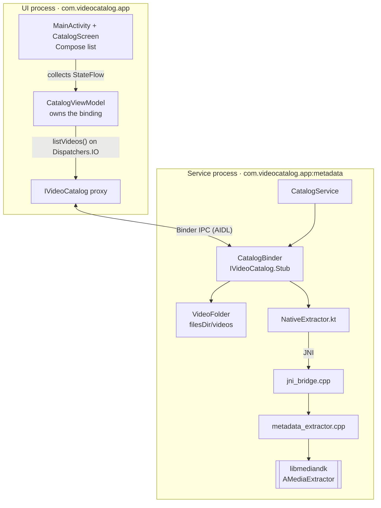
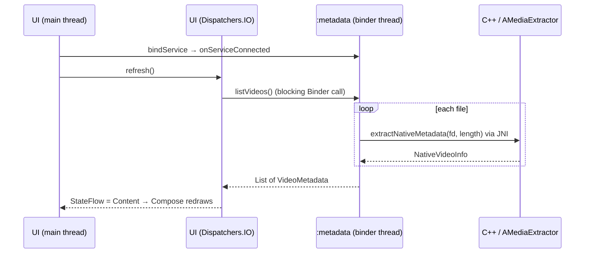

# Video Metadata Catalog

An Android app that lists the video files in a folder owned by a service. For each file it shows the **duration, dimensions, video MIME type and whether the file has audio**.

The UI and the service run in **separate processes**. Metadata is extracted in C++ with the NDK `AMediaExtractor`:

```
Client (UI) → AIDL → Service → JNI → NDK AMediaExtractor → Service → AIDL → Client (UI)
```

## Architecture

| What                     | Name                            |
| ------------------------ | ------------------------------- |
| Application ID (one APK) | `com.videocatalog.app`          |
| UI process               | `com.videocatalog.app`          |
| Service process          | `com.videocatalog.app:metadata` |
| Native library           | `libvideo_metadata.so`          |

### Components



### Project layout

| Path                                      | What it is                                                   |
| ----------------------------------------- | ------------------------------------------------------------ |
| `app/src/main/aidl/com/videocatalog/app/` | The IPC contract: `IVideoCatalog` (one call, `listVideos()`), `VideoMetadata` (one row), `ExtractStatus` (OK / no video / unreadable) |
| `app/src/main/java/.../client/`           | UI process: `MainActivity`, `CatalogScreen` (Compose), `CatalogViewModel` (binds to the service, exposes one `StateFlow`) |
| `app/src/main/java/.../service/`          | Service process: `CatalogService`, `CatalogBinder` (implements the AIDL call), `VideoFolder` (the service's private folder), `NativeExtractor` + `NativeVideoInfo` (Kotlin side of JNI) |
| `app/src/main/cpp/`                       | `jni_bridge.cpp` (JNI registration and conversion), `metadata_extractor.cpp` (the `AMediaExtractor` code), `CMakeLists.txt` |
| `app/src/main/assets/samples/`            | The six test files                                           |
| `tools/make_videos.sh`                    | Recreates the test files with ffmpeg                         |
| `app/src/main/AndroidManifest.xml`        | Declares the service in its own process: `android:process=":metadata"` |

### How it works, step by step

1. **Start.** `MainActivity` gets `CatalogViewModel`, which binds to `CatalogService` with an explicit intent. Android starts the service in its own process, `:metadata`.
2. **Connect.** `onServiceConnected` wraps the returned `IBinder` in the AIDL proxy (`IVideoCatalog.Stub.asInterface`) and calls `refresh()`.
3. **Request.** `refresh()` shows Loading and calls `listVideos()` on `Dispatchers.IO`, because a Binder call blocks until the reply arrives.
4. **Folder.** In the service, the call runs on a binder thread. `VideoFolder` first copies any missing bundled sample from `assets/samples/` into `filesDir/videos` (once per service start), then lists the regular files, sorted by name.
5. **Open.** For each file, `CatalogBinder` opens a read-only `ParcelFileDescriptor`. Kotlin owns the fd: `use {}` closes it after the native call.
6. **JNI.** `NativeExtractor.extractNativeMetadata(fd, length)` enters C++. The native method was bound by `RegisterNatives` when `JNI_OnLoad` ran on first use.
7. **Extract.** `metadata_extractor.cpp` calls `AMediaExtractor_setDataSourceFd`. The framework `dup()`s the fd and parses only the container headers (by default in the sandboxed `media.extractor` system process). The code takes the first video track's MIME type, width, height and duration, and sets `hasAudio` if any track is audio. Nothing is decoded. RAII frees every NDK handle.
8. **Back to Kotlin.** `jni_bridge.cpp` turns the C++ result into a `NativeVideoInfo` object. `CatalogBinder` copies it into an AIDL `VideoMetadata`.
9. **Reply.** The list of `VideoMetadata` is parcelled into one Binder reply to the UI process.
10. **Show.** The ViewModel sets `StateFlow` to Content, and Compose redraws. Duration and size are formatted only in the UI; the IPC carries raw values.

### Runtime flow



The Binder call never runs on the main thread. The service creates no threads: each call runs on the binder thread that received it and shares no mutable state, so concurrent calls are safe without locks.

### Errors and recovery

| What happens                            | Result                                                       |
| --------------------------------------- | ------------------------------------------------------------ |
| File isn't media, is empty or truncated | Row "Unreadable file"; the other rows are unaffected         |
| Valid media without a video track       | Row "No video track", with the audio flag                    |
| File can't be opened                    | `IOException` caught per file → "Unreadable file" row        |
| Service process dies (crash or killed)  | UI shows "Service stopped, reconnecting…"; Android restarts the service and the list reloads by itself |
| Binding dies for good (`onBindingDied`) | The ViewModel unbinds and binds again                        |
| Refresh tapped during a load            | The older request is cancelled, so a stale reply never overwrites a newer one |

### Key decisions

| Area        | Decision                                                     | Why                                                          |
| ----------- | ------------------------------------------------------------ | ------------------------------------------------------------ |
| Processes   | One APK, service in `android:process=":metadata"`, `exported="false"` | Meets the two-process requirement with one attribute; a native crash can't take down the UI |
| AIDL        | One blocking call, `List<VideoMetadata> listVideos()`        | Simplest correct design for a small folder; no path parameter, so the client can't name files |
| Data model  | Structured AIDL parcelable + `ExtractStatus` enum (default `UNREADABLE`) | Contract lives in `.aidl` files; per-file errors are data, so one bad file never fails the list |
| Folder      | `filesDir/videos`, missing samples copied from `assets/samples/` on a binder thread | App-private storage the service owns; zero-setup demo; no disk I/O on the main thread |
| JNI         | `extractNativeMetadata(fd, length)` returns a typed `NativeVideoInfo`; `RegisterNatives` in `JNI_OnLoad` | Kotlin owns the file, C++ only borrows the fd; name or signature errors fail at load time |
| Native code | C++20, RAII (`unique_ptr`) over `AMediaExtractor` / `AMediaFormat`, `-fvisibility=hidden` | Every handle released on every path; metadata only, nothing is decoded; only `JNI_OnLoad` is exported |
| Client      | ViewModel owns the binding; one `StateFlow`; Compose UI      | Survives rotation and day/night switches; reconnects automatically if the service dies |
| Build       | Single module, CMake, `minSdk 33`, `@Keep` on JNI classes    | One APK for phone and Android Automotive; R8 can't break the JNI lookups |

### Limitations

- The whole list travels in one Binder reply (1 MB buffer), which is fine for a small folder.
- New files appear only after **Refresh**.

### Future improvements

- Instrumented and native (GoogleTest) tests.
- More metadata: frame rate, bitrate, audio channels, rotation.
- Different Media sources

## Build

You need:
- Android Studio with the SDK, **NDK (Side by side)** and **CMake** installed (SDK Manager → SDK Tools).
- A device or emulator running **Android 13 (API 33) or newer**, `x86_64` or `arm64-v8a`. Phones and **Android Automotive** both work (tested on the Automotive emulator, API 35).
- `adb` on your `PATH` for the demo commands (it is in `<Android SDK>/platform-tools`).

```bash
git clone https://github.com/anaskhamees/video-metadata-catalog.git
cd video-metadata-catalog
./gradlew installDebug      # builds the Kotlin app and the C++ library (via CMake), then installs it
```

Or open the folder in Android Studio, let Gradle sync, start an emulator and press **Run**.

## Run

Launch **Video Catalog**. On start, the service copies the bundled samples from `assets/samples/` into its private folder (`files/videos`) and returns the list. No setup is needed: you should see 6 rows, 4 videos, 1 "No video track" row and 1 "Unreadable file" row (expected values in [Test files](#test-files)).

## Demonstrate

If you want to try different scenarios :

`run-as` needs a debug build (`installDebug` or Android Studio's Run). Set these once per terminal:

```bash
PKG=com.videocatalog.app
U=$(adb shell am get-current-user | tr -d '\r')   # 0 on a phone, usually 10 on Android Automotive
```

On Android Automotive the app runs as the current user, not user 0, so `--user` is passed **after** the package name in every `run-as` command below.

**1. Client and service are separate processes.** Two lines with different PIDs: `com.videocatalog.app` and `com.videocatalog.app:metadata`.

```bash
adb shell ps -A | grep videocatalog
```

**2. The folder belongs to the service.** It is in the app's private storage, `files/videos`.

```bash
adb shell "run-as $PKG --user $U ls -l files/videos"
```

**3. Add your own file.** Then tap **Refresh**: a new row appears.

```bash
adb push clip.mp4 /data/local/tmp/
adb shell "run-as $PKG --user $U cp /data/local/tmp/clip.mp4 files/videos/"
```

**4. Remove one file.** Then tap **Refresh**: the row is gone.

```bash
adb shell "run-as $PKG --user $U rm files/videos/not_a_video.mp4"
```

**5. Empty folder.** Then tap **Refresh**: "No files in the service folder."

```bash
adb shell "run-as $PKG --user $U sh -c 'rm -f files/videos/*'"
```

**6. The UI survives a service crash.** The UI shows "Service stopped, reconnecting…", Android restarts the service, and the list reloads by itself.

```bash
adb shell "run-as $PKG --user $U kill -9 \$(pidof $PKG:metadata)"
```

**7. Restore the samples.** Missing samples are copied back when the service starts again. Files you added are never touched.

```bash
adb shell am force-stop $PKG
adb shell am start -n $PKG/.client.MainActivity
```

**8. The values are correct.** Compare each row with `ffprobe` on the same file:

```bash
ffprobe -v error -show_entries stream=codec_type,codec_name,width,height:format=duration -of compact FILE
```

## Test files

The six files are in `app/src/main/assets/samples/` and are bundled in the APK, so the demo needs no setup and everyone sees the same expected values. They are generated with ffmpeg test patterns: reproducible, tiny (about 2.4 MB in total) and free of licensing issues.

Each file covers a different case, and they differ in codec, size and duration, so a value read from the wrong track or hard-coded would show up immediately:

| File | Expected row | Why it is included |
|---|---|---|
| `h264_aac_720p.mp4` | 0:05 · 1280×720 · `video/avc` · Audio: yes | Baseline: the most common format. |
| `h264_noaudio_480p.mp4` | 0:15 · 640×480 · `video/avc` · Audio: no | Shows that "has audio" comes from the tracks. |
| `hevc_aac_1080p.mp4` | 1:40 · 1920×1080 · `video/hevc` · Audio: yes | A second codec in the same container, and a duration over one minute. Only the container is parsed, so no HEVC decoder is needed. |
| `vp9_opus_360p.webm` | 0:06 · 640×360 · `video/x-vnd.on2.vp9` · Audio: yes | A different container (WebM) with different codecs. |
| `audio_only.m4a` | No video track · Audio: yes | Valid media without video. |
| `not_a_video.mp4` | Unreadable file | Text behind a video extension must give an error row, not a crash. |

### Generating the samples

The script `tools/make_videos.sh` recreates all six files in `app/src/main/assets/samples/`. It needs ffmpeg with libx264, libx265, libvpx and libopus. The standard Ubuntu/Debian package has all four (check with `ffmpeg -encoders`).

```bash
sudo apt install ffmpeg      # Ubuntu/Debian; on macOS: brew install ffmpeg
tools/make_videos.sh         # writes the six files and lists their sizes
```

These are the commands it runs (`testsrc` is a moving test pattern, `sine` a test tone):

```bash
cd app/src/main/assets/samples
ffmpeg -f lavfi -i testsrc=size=1280x720:rate=30:duration=5 -f lavfi -i sine=frequency=440:duration=5 -c:v libx264 -pix_fmt yuv420p -c:a aac h264_aac_720p.mp4
ffmpeg -f lavfi -i testsrc=size=640x480:rate=25:duration=15 -c:v libx264 -pix_fmt yuv420p -an h264_noaudio_480p.mp4
ffmpeg -f lavfi -i testsrc=size=1920x1080:rate=30:duration=100 -f lavfi -i sine=frequency=660:duration=100 -c:v libx265 -tag:v hvc1 -pix_fmt yuv420p -c:a aac hevc_aac_1080p.mp4
ffmpeg -f lavfi -i testsrc=size=640x360:rate=30:duration=6 -f lavfi -i sine=frequency=880:duration=6 -c:v libvpx-vp9 -b:v 300k -c:a libopus vp9_opus_360p.webm
ffmpeg -f lavfi -i sine=frequency=440:duration=4 -c:a aac audio_only.m4a
echo "this is not a video" > not_a_video.mp4
```

After regenerating, rebuild and **clear the app data** so the service copies the new versions. It only copies samples that are missing from its folder, so it never overwrites existing ones:

```bash
./gradlew installDebug
adb shell pm clear --user $U com.videocatalog.app
```

### Extra files for live testing

More cases to try with Demonstrate step 3. Create them anywhere, for example in `/tmp`:

```bash
# Another container (Matroska): 0:07 · 800×600 · video/avc · Audio: yes
ffmpeg -f lavfi -i testsrc=size=800x600:rate=30:duration=7 -f lavfi -i sine=duration=7 -c:v libx264 -pix_fmt yuv420p -c:a aac other_container.mkv

# Portrait video, checks width/height are not swapped: 0:03 · 720×1280 · video/avc · Audio: no
ffmpeg -f lavfi -i testsrc=size=720x1280:rate=30:duration=3 -c:v libx264 -pix_fmt yuv420p portrait_720x1280.mp4

# Over ten minutes but tiny (2 fps, 320×240): 10:05 · 320×240 · video/avc · Audio: no
ffmpeg -f lavfi -i testsrc=size=320x240:rate=2:duration=605 -c:v libx264 -pix_fmt yuv420p long_10min.mp4

# Empty file: Unreadable file
: > empty.mp4

# Truncated video (first 4 KB only; the MP4 index is at the end): Unreadable file, no crash
head -c 4096 portrait_720x1280.mp4 > truncated.mp4
```

Copy them all into the service folder, then tap **Refresh**:

```bash
for f in other_container.mkv portrait_720x1280.mp4 long_10min.mp4 empty.mp4 truncated.mp4; do
  adb push "$f" /data/local/tmp/
  adb shell "run-as $PKG --user $U cp /data/local/tmp/$f files/videos/"
done
```

Any real video from your computer works the same way: push it and copy it with step 3.

## AI usage

AI assistants were used for design discussion, code review and documentation. All code was written or reviewed, built and tested by me on an Android Automotive emulator (API 35).
